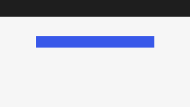

# Create a post

After this tutorial you have a published post with a heading, a paragraph and an image.

## Before you start

You need an account that can publish posts. If you have not installed WordPress yet, start with [Install WordPress](../get-started/install-wordpress.md).

## Add a title

Click **Posts > Add New Post** and type a title.

> [!NOTE]
> The title becomes the post's URL slug unless you change it.

> [!IMPORTANT]
> Save often: press <kbd>Ctrl</kbd> + <kbd>S</kbd> (or <kbd>⌘</kbd> + <kbd>S</kbd> on a Mac).

## Add blocks

Press <kbd>/</kbd> to search for a block. See the [formatting reference](formatting.md#keyboard-shortcuts) for more.

> [!CAUTION]
> Deleting a block cannot be undone after you leave the editor.

## Publish

Click **Publish**, then **Publish** again to confirm. Read more on [WordPress.org](https://wordpress.org/documentation/).
